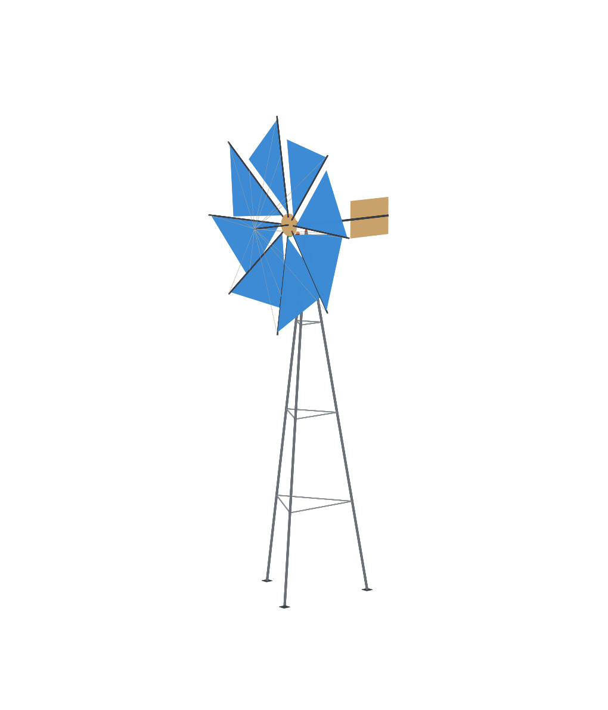

# Punta Mita wind machine v2

7 m cloth-sail rotor that turns into the wind, on a 12 m steel tripod bolted to a concrete pad. Supersedes `SAIL_WINDMILL.md`.

**Assumptions:** NASA POWER wind for 2022–2024 unchanged at this spot, a sound 4 x 4 m pad, published sail-rotor efficiency, and estimated prices where marked.

- **Output:** 112 W average, 981 kWh a year (203 W if the spot is 1.3× windier).
- **Parts:** about $2,708, of which $1,762 is at prices seen on seller pages.
- **Cost of energy:** about $687 per MWh over five years ($378 at 1.3× wind).
- **Reef the sails above 7.1 m/s.** Lower the tower for any tropical storm or hurricane warning.

## Structural simulation (12 wind directions)

| Case | Lowest safety factor | Where | Pull per foot |
|---|---|---|---|
| 7.8 m/s, working | 2.31 | spar | 311 kg |
| 12 m/s gust, sails up | 2.09 | leg | 819 kg |
| 17 m/s squall, sails up | 1.32 | leg | 1707 kg |
| 25 m/s storm, sails reefed | 1.49 | leg | 687 kg |
| 30 m/s, sails removed | 1.05 | leg | 584 kg |
| 35 m/s, sails removed | 0.76 | leg | 817 kg |
| 40 m/s, sails removed | 0.58 | leg | 1086 kg |
| 45 m/s hurricane, sails removed | 0.45 | leg | 1391 kg |

A safety factor below 1 means failure. **The standing tower does not survive 35 m/s or more, so it must be lowered before a storm.**

## Order list

### Carry in from the US (about $599)

| Item | Qty | Unit | Price | Note |
|---|---|---|---|---|
| [48 V 1,200 W direct-drive REAR hub motor wheel, 700C](https://ebikeling.com/products/waterproof-48v-1200w-700c-direct-drive-front-rear-ebike-motor-wheel-only) | 1 | $239.99 | seen | Generator. Confirm it has a screw-on freewheel thread before paying. |
| [1,000 W wind MPPT charge controller, 12/24/48 V](https://www.ato.com/1000w-wind-turbine-mppt-charge-controller) | 1 | $178.46 | seen | Holds the rotor at its best speed. |
| [3-phase bridge rectifier, 90 A](https://windandsolar.com/products/3-phase-rectifier-90-amp) | 1 | $20.65 | seen |  |
| [300 W dump resistor, 2.9 ohm](https://windandsolar.com/products/300-watt-divert-load-resistor) | 4 | $10.55 | seen | Test load and overspeed protection. |
| [Victron SmartShunt 500 A](https://shopsolarkits.com/products/victron-smartshunt) | 1 | $117.30 | seen | Logs power to your phone. |

### Home Depot Las Juntas (about $1,164)

| Item | Qty | Unit | Price | Note |
|---|---|---|---|---|
| [Galvanised post tube 73 mm x 3.05 m](https://www.homedepot.com.mx/p/tauro-tuberia-para-postes-73-mm-std-305-m-851969) | 12 | MX$545.00 | seen | Three legs, four tubes each. |
| [Thin-wall conduit 1 in x 3 m](https://www.homedepot.com.mx/p/rymco-tubo-conduit-metal-pared-delgada-1-pulgada-sin-rosca-830785) | 21 | MX$249.00 | seen | 9 braces, 12 cut into 36 one-metre leg splints. |
| [Thin-wall conduit 1-1/4 in x 3 m](https://www.homedepot.com.mx/b/electrico/conduit-cajas-y-accesorios/tuberia-conduit) | 17 | MX$329.00 | seen | 8 spars of two sleeved lengths, plus bowsprit. Wall thickness not shown online: check it is about 1.65 mm. |
| [Polyethylene tarp 9.14 x 6.09 m](https://www.homedepot.com.mx/p/everbilt-lona-para-pintar-uso-general-914-x-609-m-polietileno-impermeable-152701-152701) | 1 | MX$2,315.00 | seen | Eight sails. Replace about yearly. |
| [Polyester rope 6.3 mm x 30 m](https://www.homedepot.com.mx/p/cuerda-de-poliester-trenzada-63-mm-304-m-mfp4100-992046) | 3 | MX$219.00 | seen | 16 stays, sheets, lashings. |
| [Plywood 15 mm, 1.22 x 2.44 m](https://www.homedepot.com.mx/p/marini-triplay-cdx-15-mm-para-construccion-165700) | 2 | MX$599.00 | seen | Hub discs and tail vane. Seal with paint. |

### Puerto Vallarta, estimate (about $946)

| Item | Qty | Unit | Price | Note |
|---|---|---|---|---|
| Welding shop: apex plate, yaw post and head beam (2 in Sch 80), 3 base plates with hinges | 1 | MX$4,500.00 | estimate | Two feet hinged so the tower can be lowered. |
| Two trailer wheel hubs with spindles | 2 | MX$900.00 | estimate | Sealed bearings: one for yaw, one for the rotor. |
| Motorcycle 428 chain, 53T and 14T sprockets | 1 | MX$1,100.00 | estimate | First gear stage. |
| Bicycle chain, 48T ring, 12T freewheel, jackshaft, 2 pillow blocks | 1 | MX$1,400.00 | estimate | Second gear stage, 15:1 overall. |
| Epoxy anchors M16 stainless (12), stainless U-bolts, bolts | 1 | MX$4,000.00 | estimate | Foot bolts must hold 1,700 kg per foot. |
| Zinc primer, marine paint, 3-core cable 20 m, lugs, grease | 1 | MX$2,200.00 | estimate | Salt protection. |
| Hand winch, 12 m of 3/16 in cable, gin pole | 1 | MX$2,500.00 | estimate | To raise and lower the tower. |

## Not verified

- Welds, bolted splices and the plywood hub are not simulated. Have the welder check the head.
- Fatigue, gust dynamics and yaw stability are not simulated.
- Pad condition and anchor pull-out strength must be checked on site.
- Raising a 12 m tower can kill someone: use the winch and gin pole, keep everyone outside the fall zone.
