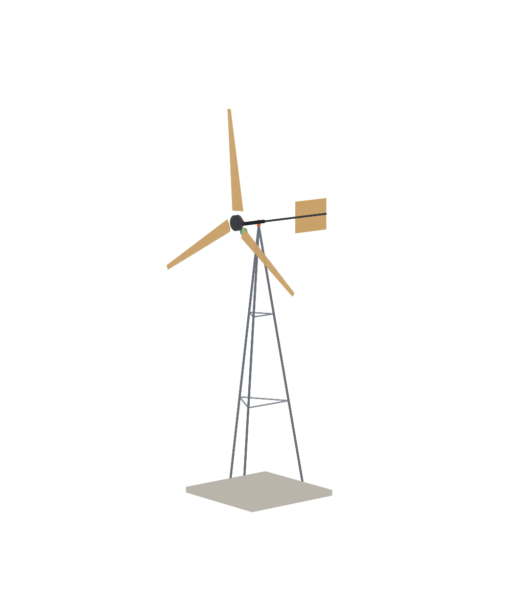

# Punta Mita wind machine v3

10 m, three-blade laminated wood rotor on a 12 m steel tripod bolted to a concrete pad. Supersedes `BUILD_V2.md`.

- **Output:** 400 W average, 3,503 kWh a year (simulated, NASA POWER wind, Cp capped at 0.38).
- **Parts:** about $5,427, of which $992 is at prices seen on seller pages. The rest is estimated. Labour is not included.
- **Cost of energy:** $134/MWh over 20 years, $340 over 5, $83 over 20 at 1.3x wind. Hot water: $103/MWh.
- **Target of $10/MWh is not reached.**

Blade: chord 0.6 to 0.2 m, thickness 110 to 35 mm, twist 12 to 0 degrees, 5 degree cone.

## Structural simulation (12 wind directions)

| Case | Lowest safety factor | Where | Pull per foot |
|---|---|---|---|
| 8 m/s working | 3.03 | tail boom | 879 kg |
| 12 m/s, furl fails | 2.30 | leg | 2238 kg |
| 17 m/s, furl fails | 1.41 | leg | 4657 kg |
| 25 m/s, furled, braked | 3.00 | tail boom | 1535 kg |
| 35 m/s, parked | 2.98 | tail boom | 3300 kg |
| 45 m/s, parked | 2.01 | leg | 5655 kg |

Tower bending 7.6 Hz and tail 2.4 Hz are clear of the 1.3 Hz maximum once-per-turn rotor speed. The pad and machine must weigh at least 10.1 t. The trailer spindle needs the yaw damper (safety factor 1.65 at 0.2 rad/s).

## Order list

### Blades (about $1,299)

| Item | Qty | Unit | Price |
|---|---|---|---|
| Pine planks 2x6 in x 8 ft, laminated (0.74 m3 with waste) | 57 | MX$300.00 | est |
| Marine epoxy, 3 gal | 3 | $37.00 | seen |
| Glass cloth, 6 kg, leading edge and skin | 6 | MX$179.20 | seen |
| Hub plates 680 mm x 12 mm, M16 bolts (24) | 1 | MX$3,800.00 | est |

### Tower (about $2,626)

| Item | Qty | Unit | Price |
|---|---|---|---|
| 3 in Sch 40 pipe, 36 m | 1 | MX$24,314.75 | est |
| 1-1/2 in Sch 40 braces, 13 m | 1 | MX$1,950.00 | est |
| Head: 5 in Sch 40, 2.5 m; tail 2-1/2 in Sch 80, 4 m | 1 | MX$5,205.00 | est |
| Welding, hinged feet, apex, galvanizing or zinc paint | 1 | MX$14,000.00 | est |
| M20 stainless epoxy anchors (12) | 12 | MX$260.00 | est |

### Drive (about $633)

| Item | Qty | Unit | Price |
|---|---|---|---|
| 7,000 lb idler hub, rotor bearing | 1 | $112.17 | seen |
| 7,000 lb idler hub, yaw bearing | 1 | $112.17 | seen |
| Two spindles | 2 | $45.00 | est |
| 530 chain, 60T and 12T sprockets | 1 | MX$2,600.00 | est |
| Disc brake, furl hinge, cable | 1 | MX$2,500.00 | est |
| Truck shock absorber as yaw damper | 1 | MX$800.00 | est |

### Electric (about $734)

| Item | Qty | Unit | Price |
|---|---|---|---|
| 48 V 1,200 W hub motor | 1 | $239.99 | seen |
| 1 kW wind MPPT controller | 1 | $178.46 | seen |
| Rectifier | 1 | $20.65 | seen |
| Dump resistors | 4 | $10.55 | seen |
| Victron shunt | 1 | $117.30 | seen |
| Cable, lugs, paint | 1 | MX$2,500.00 | est |

### Lift (about $135)

| Item | Qty | Unit | Price |
|---|---|---|---|
| Hand winch, cable, gin pole | 1 | MX$2,500.00 | est |

## Not verified

- Laminated blade strength, glue lines, welds, pipe splices and fatigue are assumed or not simulated.
- Furling, yaw damping and braking have not been dynamically simulated.
- Pad weight, condition and anchor pull-out must be checked on site.
- Lower the tower before any tropical storm. Raising a 12 m tower with a 215 kg rotor can kill someone: use a rigger, a winch and a clear fall zone.
