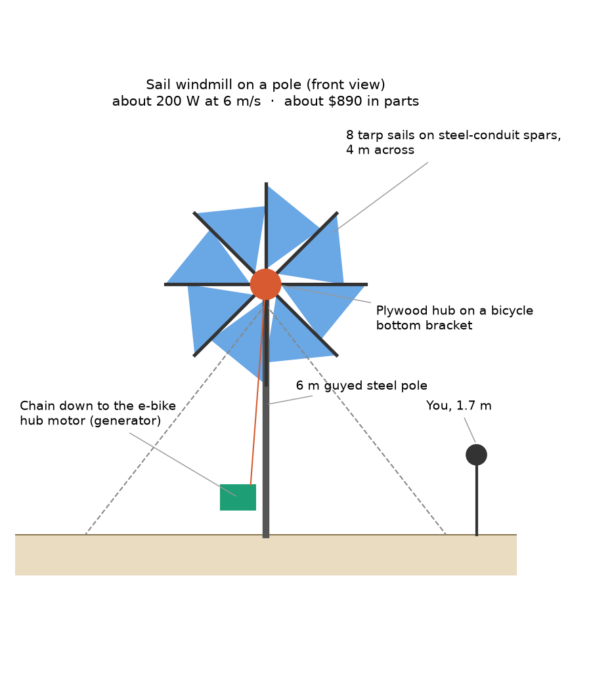

# Punta Mita prototype: 5 m cloth-sail windmill on a pole

Chosen after simulating nine concepts in three years of hourly Punta Mita wind (see `results/concepts.json`). Prices seen 22 Nov 2026; Home Depot prices are the online prices.

## What the simulation predicts

Whole system: rotor → two bicycle chains (48:14, then 28:14, 6.9:1 overall) → hub motor → rectifier → two 2.9 Ω resistors in parallel. At each wind speed the machine settles where rotor torque equals generator torque.

| Wind | Rotor speed | Volts | Amps | Electrical power | Pole thrust | Chain tension |
|---|---|---|---|---|---|---|
| 3 m/s | 14 rpm | 7 V | 5 A | 37 W | 61 N | 359 N |
| 4 m/s | 22 rpm | 12 V | 8 A | 94 W | 121 N | 576 N |
| 5 m/s | 30 rpm | 16 V | 11 A | 188 W | 207 N | 812 N |
| 6 m/s | 38 rpm | 22 V | 15 A | 319 W | 305 N | 1060 N |
| 7 m/s | 47 rpm | 27 V | 19 A | 496 W | 385 N | 1322 N |

- Year-round at Punta Mita (dataset wind): **69 W average, 607 kWh a year**.
- Parts: **about $1,019**, plus about $165 for four replacement tarps (sails last about a year in the sun). Over five years that is 3.0 MWh, about **$390 per MWh**.
- Optimised over rotor size, number and width of sails, gearing, load and reefing speed (2,009 feasible combinations). The second chain is what matters: it lets a bigger rotor load the generator properly.
- Stretch version: a 6 m rotor on a 9 m pole makes about 90 W average ($345 per MWh) but is a much bigger thing to raise; build the 5 m first.
- Uncertainty: rotor efficiency is taken from published sail-rotor tests (20–30% of the wind's power) with a 0.75 site factor; the wind is a 50 km reanalysis grid, not your beach. Expect the real figure within roughly half to double.

## Order list (about $1,019)

### Bring with you (order now, US) (about $450)

| Item | Qty | Unit price | Price | Note |
|---|---|---|---|---|
| [48 V 1,200 W direct-drive REAR hub motor wheel, 700C (ebikeling)](https://ebikeling.com/products/waterproof-48v-1200w-700c-direct-drive-front-rear-ebike-motor-wheel-only) | 1 | $239.99 | seen | The generator. Must be the rear version with a screw-on freewheel thread; ask the seller before paying. About 7 kg. |
| Single-speed freewheel, 14 tooth, standard 1.37 in thread, plus one spare bicycle chain | 1 | $30.00 | estimate | Any bike shop. The freewheel goes on the hub motor; the spare chain is the second stage. |
| [3-phase bridge rectifier 90 A](https://windandsolar.com/products/3-phase-rectifier-90-amp) | 1 | $20.65 | seen | Bolt to a metal plate. |
| [300 W load resistor, 24 V version (2.9 ohm)](https://windandsolar.com/products/300-watt-divert-load-resistor) | 4 | $10.55 | seen | Two wired in parallel (1.45 ohm) is the best match; the others let you try three or four in parallel and act as spares. |
| [Victron SmartShunt 500 A power logger](https://shopsolarkits.com/products/victron-smartshunt) | 1 | $117.30 | seen | Reads volts, amps and watt-hours on your phone from 6.5 V up. |

### Home Depot Las Juntas, Puerto Vallarta (about $442)

| Item | Qty | Unit price | Price | Note |
|---|---|---|---|---|
| [Galvanised post tube 73 mm × 3.05 m (Tauro)](https://www.homedepot.com.mx/p/tauro-tuberia-para-postes-73-mm-std-305-m-851969) | 2 | MX$545.00 | seen | The 6 m pole, joined with an internal wooden plug and through-bolts; guy it at the joint and at the top. |
| [Galvanised steel cable 3/16 in, per metre](https://www.homedepot.com.mx/p/fiero-cable-de-acero-galvanizado-3-16-venta-por-metro-lineal-cab-3-16r-466137) | 40 | MX$27.00 | seen | Six guys (three at the top, three at the joint). Rated 1,360 kg; peak simulated guy load is about 95 kg. |
| [Cable clamps 3/16 in, pack of 2](https://www.homedepot.com.mx/p/fiero-accesorio-para-cable-3-16-hierro-2-piezas-nudo-3-16-237091) | 12 | MX$22.00 | seen | Check the photo matches a U-bolt cable clamp. |
| [Steel conduit, thin wall, 1 in × 3 m](https://www.homedepot.com.mx/p/rymco-tubo-conduit-metal-pared-delgada-1-pulgada-sin-rosca-830785) | 9 | MX$249.00 | seen | Eight spars cut to 2.5 m plus one bowsprit. Offcuts become anchor stakes. |
| [Polyethylene tarp 4.87 × 3.65 m, general use](https://www.homedepot.com.mx/p/everbilt-lona-para-pintar-uso-general-487-x-365-m-polietileno-impermeable-152699-152699) | 1 | MX$765.00 | seen | Eight triangular sails, about 1.6 m² each. |
| [Polyester braided rope 6.3 mm × 30 m](https://www.homedepot.com.mx/p/cuerda-de-poliester-trenzada-63-mm-304-m-mfp4100-992046) | 2 | MX$219.00 | seen | Stays from bowsprit to spar tips, sail sheets, lashings. |
| [Plywood 15 mm, 1.22 × 2.44 m](https://www.homedepot.com.mx/p/marini-triplay-cdx-15-mm-para-construccion-165700) | 1 | MX$599.00 | seen | Two 50 cm hub discs that sandwich the spars; the rest is the electronics board. |
| [Duct tape 48 mm × 55 m](https://www.homedepot.com.mx/s/cinta%20ducto) | 1 | MX$199.00 | seen | Sail edges and chafe points. |
| U-bolts, M8 bolts, washers, 10 AWG wire (15 m), lugs | 1 | MX$1,500.00 | estimate | My allowance. |

### Puerto Vallarta, other (about $127)

| Item | Qty | Unit price | Price | Note |
|---|---|---|---|---|
| Used adult bicycle with a 48-tooth chainring and a 7-speed rear cluster (14 to 28 teeth) | 1 | MX$1,850.00 | estimate | Its crank is the rotor shaft and its own rear wheel is the step-up shaft: chain one runs chainring to the 14-tooth cog, chain two runs from the 28-tooth cog to the hub motor. Price is my guess. |
| [Steren HER-445 digital anemometer](https://www.steren.com.mx/catalogsearch/result/?q=anemometro) | 1 | MX$495.00 | seen |  |

## Build

1. **Hub.** Cut two 50 cm plywood discs. Clamp the eight 2.5 m conduit spars between them like wheel spokes (45° apart) with U-bolts, inner ends 15 cm from centre. Bolt the disc pair to the bicycle's right crank and chainring so the crank axle is the rotor shaft.
2. **Bowsprit and stays.** Fix a 1.0 m conduit to the hub centre pointing upwind. Run a rope from its tip to each spar tip and tension them evenly. The strength check assumes the stays are fitted.
3. **Sails.** Cut eight right triangles from the tarp: 2.3 m along the spar, 1.4 m along the foot. Tape and fold the edges. Lash the long edge to a spar; tie the free corner to the next spar's tip with a 0.3 m sheet so the sail can belly. Loose sails outperform tight ones.
4. **Drivetrain.** Keep the bicycle frame whole. Chain one: 48-tooth chainring to the 14-tooth cog of the bike's own rear wheel (tyre off; lock the derailleur or shorten the chain). Chain two: from the 28-tooth cog of that same cluster to the 14-tooth freewheel on the hub motor wheel, which you clamp behind the rear wheel on a plywood-and-conduit bracket with the sprockets in line. Overall 6.9:1. Check both freewheels drive in the direction the sails turn.
5. **Pole.** Join the two post tubes with a 60 cm hardwood plug and four through-bolts. Clamp the bicycle frame to the top with U-bolts so the rotor faces the afternoon sea breeze. Three guys from the top and three from the joint, each to a 1 m conduit stake driven at 45° or a plank buried 0.8 m deep in damp sand.
6. **Electrics.** Three motor phase wires down the pole → rectifier → shunt → two resistors in parallel, on a plywood board in the shade. Resistors get hot: keep them off anything that burns.
7. **Raising.** Assemble flat on the sand with sails off, walk the pole up with two people on guys, tension, then tie the sails on from a ladder or lower the pole to rig them.

## Test plan

1. Log wind at head height and at the top of the pole for two afternoons before building.
2. Spin the rotor by hand with sails off: confirm volts rise with speed (about 0.6 V per rotor rpm) and the freewheel direction is right.
3. First run with four sails in 4–5 m/s; then all eight.
4. Record wind, volts, amps for ten minutes at each wind speed and compare with the table above. Try two and four resistors in parallel to see the match change.

## Safety

- Reef (wrap each sail round its spar) above 7 m/s, when the two load resistors reach their heat limit (use four in parallel to run to about 9 m/s), and before leaving it unattended. The highest hour in three years of data was 17 m/s.
- Blade tips are 3.5 m above the sand and move at about 10 m/s in a 6 m/s breeze: rope off the area under and downwind of the rotor.
- With no load connected the rotor overspeeds: always connect the resistors before untying the sails.
- Rinse salt off the hub motor and chain; keep the rectifier and shunt dry.
