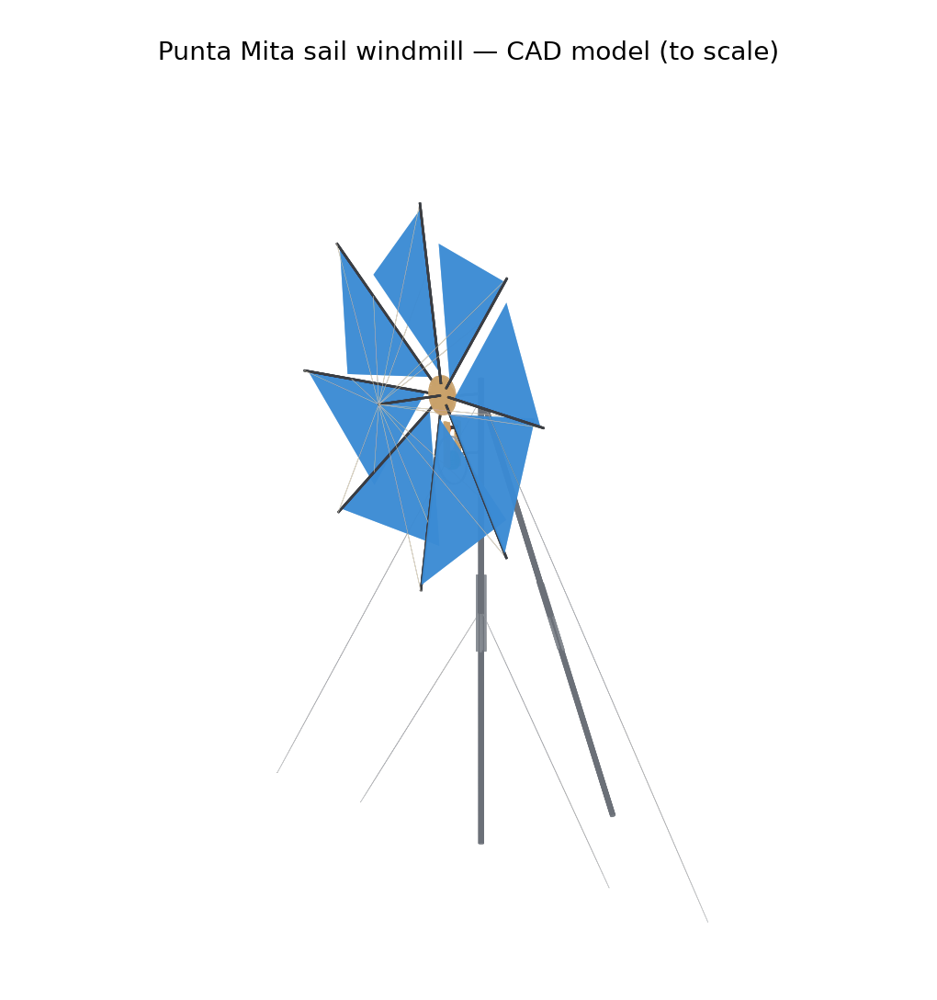

# Punta Mita prototype: 5 m cloth-sail windmill on a pole

> **Correction:** the 69 W / $425 per MWh below is too optimistic. An audit (`models/energy_audit.py`) found it ignored wind direction, the 6 m hub height and drivetrain drag. As drawn (rotor fixed facing one way) expect about 22 W ($1,328/MWh). With a rotor that yaws into the wind, about 41 W ($758/MWh). **Do not order the tower parts until the yawing tower is finished.**

Chosen after simulating nine concepts in three years of hourly Punta Mita wind (see `results/concepts.json`). Prices seen 22 Nov 2026; Home Depot prices are the online prices.

## What the simulation predicts

Whole system: rotor → two bicycle chains (48:14, then 28:14, 6.9:1 overall) → hub motor → rectifier → two 2.9 Ω resistors in parallel. At each wind speed the machine settles where rotor torque equals generator torque.

| Wind | Rotor speed | Volts | Amps | Electrical power | Pole thrust | Chain tension |
|---|---|---|---|---|---|---|
| 3 m/s | 14 rpm | 7 V | 5 A | 37 W | 61 N | 359 N |
| 4 m/s | 22 rpm | 12 V | 8 A | 94 W | 121 N | 576 N |
| 5 m/s | 30 rpm | 16 V | 11 A | 188 W | 207 N | 812 N |
| 6 m/s | 38 rpm | 22 V | 15 A | 319 W | 305 N | 1060 N |
| 7 m/s | 47 rpm | 27 V | 19 A | 496 W | 385 N | 1322 N |

- Year-round at Punta Mita (dataset wind): **69 W average, 607 kWh a year**.
- Parts: **about $1,125**, plus about $165 for four replacement tarps (sails last about a year in the sun). Over five years that is 3.0 MWh, about **$425 per MWh**.
- Optimised over rotor size, number and width of sails, gearing, load and reefing speed (2,009 feasible combinations). The second chain is what matters: it lets a bigger rotor load the generator properly.
- Stretch version: a 6 m rotor on a 9 m pole makes about 90 W average ($345 per MWh) but is a much bigger thing to raise; build the 5 m first.
- Uncertainty: rotor efficiency is taken from published sail-rotor tests (20–30% of the wind's power) with a 0.75 site factor; the wind is a 50 km reanalysis grid, not your beach. Expect the real figure within roughly half to double.

## Order list (about $1,125)

### Bring with you (order now, US) (about $450)

| Item | Qty | Unit price | Price | Note |
|---|---|---|---|---|
| [48 V 1,200 W direct-drive REAR hub motor wheel, 700C (ebikeling)](https://ebikeling.com/products/waterproof-48v-1200w-700c-direct-drive-front-rear-ebike-motor-wheel-only) | 1 | $239.99 | seen | The generator. Must be the rear version with a screw-on freewheel thread; ask the seller before paying. About 7 kg. |
| Single-speed freewheel, 14 tooth, standard 1.37 in thread, plus one spare bicycle chain | 1 | $30.00 | estimate | Any bike shop. The freewheel goes on the hub motor; the spare chain is the second stage. |
| [3-phase bridge rectifier 90 A](https://windandsolar.com/products/3-phase-rectifier-90-amp) | 1 | $20.65 | seen | Bolt to a metal plate. |
| [300 W load resistor, 24 V version (2.9 ohm)](https://windandsolar.com/products/300-watt-divert-load-resistor) | 4 | $10.55 | seen | Two wired in parallel (1.45 ohm) is the best match; the others let you try three or four in parallel and act as spares. |
| [Victron SmartShunt 500 A power logger](https://shopsolarkits.com/products/victron-smartshunt) | 1 | $117.30 | seen | Reads volts, amps and watt-hours on your phone from 6.5 V up. |

### Home Depot Las Juntas, Puerto Vallarta (about $548)

| Item | Qty | Unit price | Price | Note |
|---|---|---|---|---|
| [Galvanised post tube 73 mm × 3.05 m (Tauro)](https://www.homedepot.com.mx/p/tauro-tuberia-para-postes-73-mm-std-305-m-851969) | 4 | MX$545.00 | seen | Two make the 6.1 m pole, two make the back-prop that leans against it from 2.2 m behind. Each pair is joined with conduit splints and U-bolts. |
| [Galvanised steel cable 3/16 in, per metre](https://www.homedepot.com.mx/p/fiero-cable-de-acero-galvanizado-3-16-venta-por-metro-lineal-cab-3-16r-466137) | 28 | MX$27.00 | seen | Four side guys only (two from the top, two from the joint). No cable may cross the rotor. Rated 1,360 kg; peak simulated load is about 35 kg. |
| [Cable clamps 3/16 in, pack of 2](https://www.homedepot.com.mx/p/fiero-accesorio-para-cable-3-16-hierro-2-piezas-nudo-3-16-237091) | 12 | MX$22.00 | seen | Check the photo matches a U-bolt cable clamp. |
| [Steel conduit, thin wall, 1 in × 3 m](https://www.homedepot.com.mx/p/rymco-tubo-conduit-metal-pared-delgada-1-pulgada-sin-rosca-830785) | 11 | MX$249.00 | seen | Eight spars cut to 2.5 m, one bowsprit, six 1 m joint splints, two standoffs. Offcuts become stakes. |
| [Polyethylene tarp 4.87 × 3.65 m, general use](https://www.homedepot.com.mx/p/everbilt-lona-para-pintar-uso-general-487-x-365-m-polietileno-impermeable-152699-152699) | 1 | MX$765.00 | seen | Eight triangular sails, about 1.6 m² each. |
| [Polyester braided rope 6.3 mm × 30 m](https://www.homedepot.com.mx/p/cuerda-de-poliester-trenzada-63-mm-304-m-mfp4100-992046) | 3 | MX$219.00 | seen | Two stays per spar (to the tip and to two-thirds span), sail sheets, lashings. |
| [Plywood 15 mm, 1.22 × 2.44 m](https://www.homedepot.com.mx/p/marini-triplay-cdx-15-mm-para-construccion-165700) | 1 | MX$599.00 | seen | Two 50 cm hub discs that sandwich the spars, two 10 × 58 cm doubled plates that carry the hub motor, a 40 cm pad under the back-prop foot, the electronics board. |
| [Duct tape 48 mm × 55 m](https://www.homedepot.com.mx/s/cinta%20ducto) | 1 | MX$199.00 | seen | Sail edges and chafe points. |
| U-bolts, M8 bolts, washers, 10 AWG wire (15 m), lugs | 1 | MX$1,500.00 | estimate | My allowance. |
| Timber 2 × 6 in, 1 m lengths, for buried anchors | 4 | MX$120.00 | estimate | One under the pole foot (it is pulled upward in strong wind), one behind the prop foot, one per side-guy pair. |

### Puerto Vallarta, other (about $127)

| Item | Qty | Unit price | Price | Note |
|---|---|---|---|---|
| Used adult bicycle with a 48-tooth chainring and a 7-speed rear cluster (14 to 28 teeth) | 1 | MX$1,850.00 | estimate | Its crank is the rotor shaft and its own rear wheel is the step-up shaft: chain one runs chainring to the 14-tooth cog, chain two runs from the 28-tooth cog to the hub motor. Price is my guess. |
| [Steren HER-445 digital anemometer](https://www.steren.com.mx/catalogsearch/result/?q=anemometro) | 1 | MX$495.00 | seen |  |

## CAD and structural check

The whole machine is modelled in CAD (`cad/sail_windmill.step`, 62 solids, built by `models/cad_model.py`) and analysed as a 3D frame with tension-only cables (`models/sail_fea.py`). Both read the same dimensions file.

The CAD model changed the design three times: the upwind guy cable passed through the spinning rotor (now a back-prop behind the pole and side guys only); the rotor is coned 8° upwind so the spars clear the hub-motor rim by 184 mm; the motor bracket was moved below the crank arm's sweep.

| Fit check | Clearance | Needed |
|---|---|---|
| Rotor to pole | 590 mm | 250 mm |
| Rotor to hub-motor rim | 184 mm | 100 mm |
| Rotor to chainring | 133 mm | 30 mm |
| Rotor to guy cables | 625 mm | 250 mm |
| Rotor to back-prop | 678 mm | 250 mm |
| Hub-motor rim to pole | 419 mm | 30 mm |
| Hub-motor rim to step-up hub | 87 mm | 20 mm |
| Crank arm sweep to bracket plates | 175 mm | 30 mm |
| Bracket plates to hub-motor rim | 55 mm | 10 mm |
| Lowest blade tip above the sand | 3474 mm | 3000 mm |
| Gap between spars at the hub disc | 88 mm | 40 mm |

| Load case | Thrust | Lowest safety factor | Where | Pole foot | Prop foot |
|---|---|---|---|---|---|
| Dead load, no wind | 0 N | 5.5 | pole stress | down 77 kg | up 2 kg, sideways 2 kg |
| 7 m/s, working (reef point) | 385 N | 3.9 | spar stress | up 18 kg | down 104 kg, sideways 39 kg |
| 12 m/s gust, sails still set | 1025 N | 2.6 | spar stress | up 181 kg | down 280 kg, sideways 105 kg |
| 17 m/s squall, sails still set (worst case) | 2058 N | 1.6 | prop buckling | up 441 kg | down 565 kg, sideways 213 kg |
| 17 m/s from behind, sails reefed | -250 N | 3.0 | spar stress | down 146 kg | up 71 kg, sideways 28 kg |

- Airborne mass: rotor 22 kg, drivetrain 19 kg, pole and prop 31 kg.
- The pole foot is pulled UP in strong wind and the prop foot pushed down and back. Both need real anchors (below).
- Not modelled: bolted joints and the plywood hub themselves, fatigue, gusts as dynamics, sand strength. Safety factors are on steel yield (230 MPa) and Euler buckling.

## Build

1. **Hub.** Cut two 50 cm plywood discs. Clamp the eight 2.5 m conduit spars between them like wheel spokes (45° apart) with U-bolts, inner ends 15 cm from centre. Bolt the disc pair to the bicycle's right crank and chainring so the crank axle is the rotor shaft.
2. **Bowsprit and stays.** Fix a 1.0 m conduit to the hub centre pointing upwind. Run two ropes from its tip to each spar: one to the tip, one to two-thirds span. Tension them until every spar tip sits 35 cm upwind of the hub plane (8° of coning). The strength and clearance checks assume this.
3. **Sails.** Cut eight right triangles from the tarp: 2.3 m along the spar, 1.4 m along the foot. Tape and fold the edges. Lash the long edge to a spar; tie the free corner to the next spar's tip with a 0.3 m sheet so the sail can belly. Loose sails outperform tight ones.
4. **Drivetrain.** Keep the bicycle frame whole, hung on the upwind face of the pole with the crank at the top (two conduit standoffs U-bolted to the pole at 5.90 m and 5.15 m). Cut the rim off the bike's rear wheel so only the hub and cog cluster remain. The hub motor sits 42 cm below that hub on two doubled-plywood plates bolted to the rear dropouts. Chain one: 48-tooth chainring to the 14-tooth cog of the bike's own rear wheel (tyre off; lock the derailleur or shorten the chain). Chain two: from the 28-tooth cog of that same cluster to the 14-tooth freewheel on the hub motor wheel, which you clamp behind the rear wheel on a plywood-and-conduit bracket with the sprockets in line. Overall 6.9:1. Check both freewheels drive in the direction the sails turn.
5. **Tower.** Pole: two post tubes butted end to end with four 1 m conduit splints clamped round the joint by U-bolts. Back-prop: the same, with two splints. The prop leans from a foot 2.2 m directly downwind of the pole to the pole at 5.7 m, lashed and U-bolted there. Side guys only: two from 5.8 m and two from the joint, straight out to each side, 4.5 m and 2.6 m from the pole. Nothing may cross in front of the pole: the rotor sweeps there.
5b. **Anchors.** Pole foot: bolt it to a 1 m timber buried 0.8 m deep; in a 12 m/s gust it is pulled up with about 180 kg. Prop foot: a 40 cm plywood pad on firm sand with a buried timber behind it; it pushes down with about 280 kg and back with about 105 kg. Side guys: a buried timber each side.
6. **Electrics.** Three motor phase wires down the pole → rectifier → shunt → two resistors in parallel, on a plywood board in the shade. Resistors get hot: keep them off anything that burns.
7. **Raising.** Assemble flat on the sand with sails off, walk the pole up with two people on guys, tension, then tie the sails on from a ladder or lower the pole to rig them.

## Test plan

1. Log wind at head height and at the top of the pole for two afternoons before building.
2. Spin the rotor by hand with sails off: confirm volts rise with speed (about 0.6 V per rotor rpm) and the freewheel direction is right.
3. First run with four sails in 4–5 m/s; then all eight.
4. Record wind, volts, amps for ten minutes at each wind speed and compare with the table above. Try two and four resistors in parallel to see the match change.

## Safety

- Reef (wrap each sail round its spar) above 7 m/s, when the two load resistors reach their heat limit (use four in parallel to run to about 9 m/s), and before leaving it unattended. The highest hour in three years of data was 17 m/s.
- Blade tips are 3.5 m above the sand and move at about 10 m/s in a 6 m/s breeze: rope off the area under and downwind of the rotor.
- With no load connected the rotor overspeeds: always connect the resistors before untying the sails.
- Rinse salt off the hub motor and chain; keep the rectifier and shunt dry.
